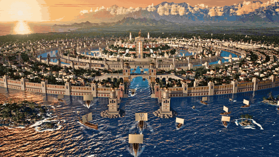
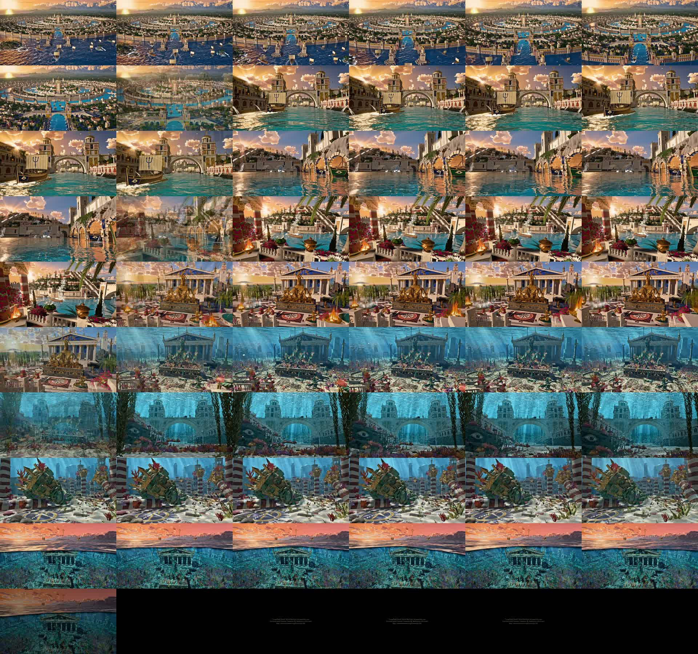
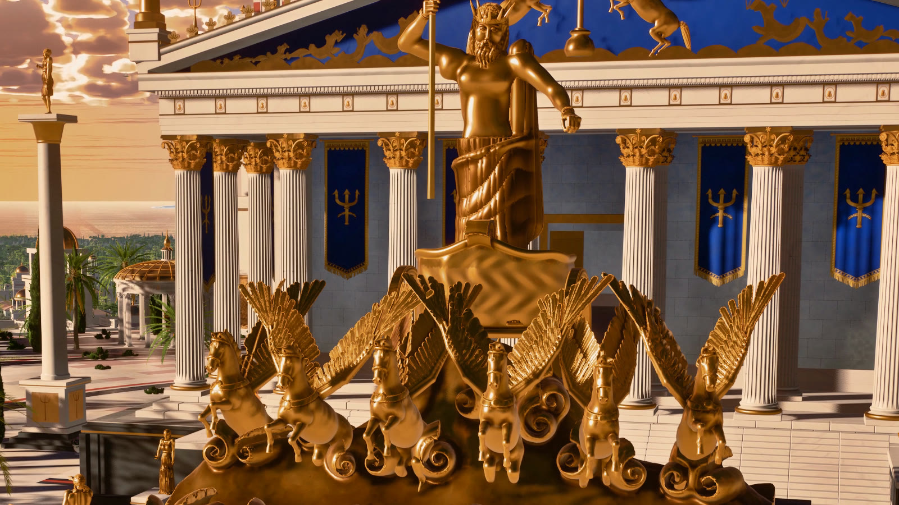
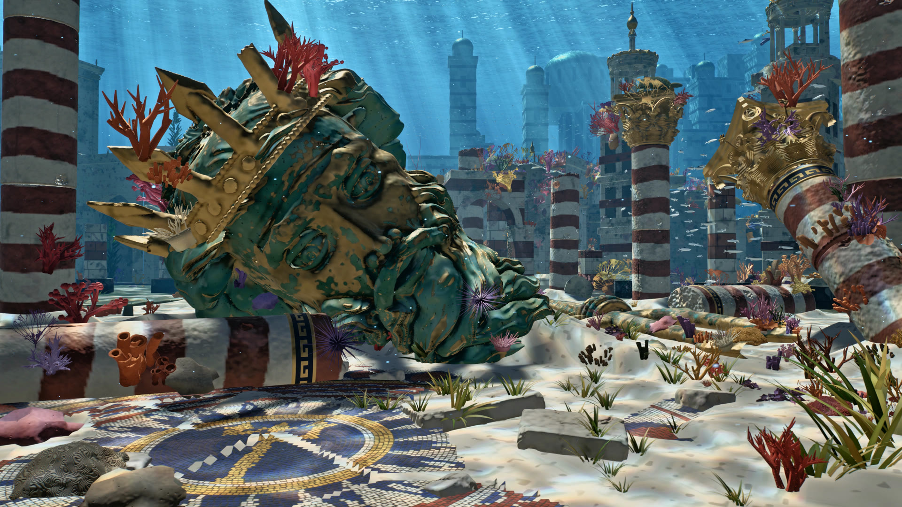
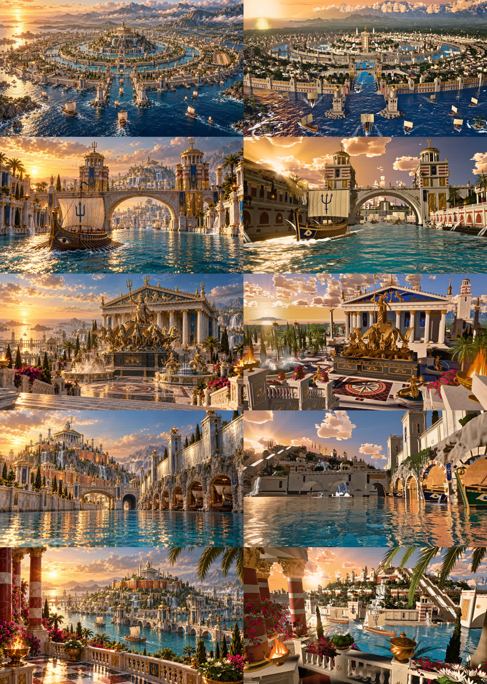
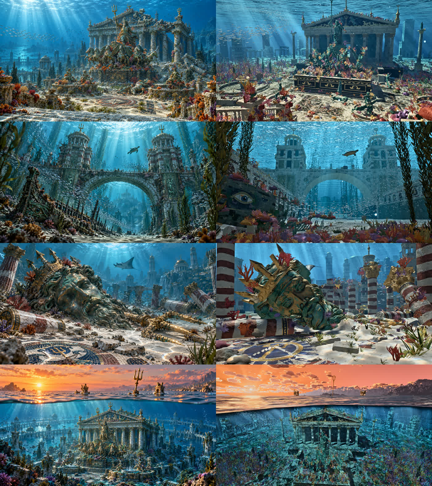

# Atlantis

Plato's Atlantis in two eras, built entirely in code with three.js. The golden age is the ring city at sunset.
The sunken era is the same city 9,000 years later, under the sea. No external assets are used: every mesh,
texture, shader, statue, ship, waterfall, coral and fish is generated procedurally. Claude Code (Opus 5.5)
directed a team of specialist agents to build it against 9 reference images, then rendered a 59 s 4K film
on an Apple M3 Ultra.

The method and the engine core come from [Athenaion](https://github.com/Leonxlnx/athenaion) (MIT). Its
source is kept for reference in [`third_party/athenaion/`](third_party/athenaion). The world modules,
both eras, the underwater renderer and the film are new.



The teaser above is a 10 s excerpt at 560 px. The film itself (3840×2160, 59 s, about 1.3 GB) is not stored in
this repository. Render it with the commands in [docs/RENDER.md](docs/RENDER.md). The contact sheet below has
one frame per second of the film:



## What's in it

- **The ring city**: a 62 m citadel hill crowned by the Temple of Poseidon, with three water rings, two land
  rings, a sea canal, moles with lighthouses, 17 km of walls clad in orichalcum, tin and bronze, 206 towers,
  ship-sheds cut into the rock, a great gate bridge and 12 ring bridges.
- **The Temple of Poseidon**: Corinthian, with a silver cella, a gold pediment relief and rearing horses, and
  gold tridents and pinnacles on the roof. In front stands a colossal chariot group, Poseidon and six winged
  horses with individually modelled feathers. All statues are sculpted as SDFs, meshed and decimated.
- **City life**: about 2,800 houses, 100+ landmarks, a racecourse and parks. The citadel stair is cut by a
  water channel, and cascades pour from the rampart outlets.
- **Water and sky**: turquoise rings, a cobalt sea and a moving fleet of triremes with wakes and bow spray.
  A low golden sun shines through shaded cumulus.
- **Vegetation**: date palms, cypress, olive and pine, planted on the real meshed ground, with LOD fixed per
  camera path so nothing pops in motion.
- **The sunken city**: an underwater medium with absorption, in-scatter and distance falloff, occluded god
  rays and animated caustics. A material overlay adds sand drifts, algae, coral crust and verdigris. Corals,
  sea fans, kelp, fish schools, a manta and a turtle fill the scene. A fallen 9 m bronze head of Poseidon lies
  on the sea floor. The last shot is a split-level view at the surface at dusk.
- **The renderer**: accumulated sub-frames per pixel (AA, soft shadows, motion blur over a 180° shutter),
  tone mapping, local tone mapping and per-shot grading. It is deterministic: the same code produces the same
  frames.

| | |
|---|---|
|  |  |

## Reference vs render

The 9 references in [`refs/`](refs) were generated with the local Codex CLI from the prompts in
[`refs/prompts/`](refs/prompts). The sunken ones were anchored on the golden ones so that the architecture
matches.




## How it was made

1. **Concept and references.** [docs/CONCEPT.md](docs/CONCEPT.md) defines the world: one layout, two eras.
   Codex generated 9 reference images, each sunken one anchored on its golden counterpart.
2. **Engine and rules.** The Athenaion engine was ported to macOS/Metal and given era support. Three documents
   set the rules: an art bible measured from the references ([docs/ART_BIBLE.md](docs/ART_BIBLE.md)), a module
   contract ([docs/CONTRACT.md](docs/CONTRACT.md)) and per-round briefs ([docs/briefs/](docs/briefs)).
3. **Rounds of specialist agents.** Every agent rendered its own work, compared it with the references
   (side-by-side views, crops, colour statistics) and fixed it in a loop. Between rounds, a director agent
   solved the cameras against reference landmarks and changed the layout where needed
   ([docs/COMPOSITION.md](docs/COMPOSITION.md)). Look-dev agents graded each era, and a perf agent profiled
   the renderer.
4. **The film.** [src/video/sequence.js](src/video/sequence.js) defines the 9 camera moves. The film renders
   era by era, frame by frame, at 24 sub-frames per frame. Cuts and the golden-to-sunken dissolve fall on
   musical phrases, and the film ends on a CC-BY credit card ([docs/RENDER.md](docs/RENDER.md)).

## Numbers

| | |
|---|---|
| Wall clock | 2026-10-20 18:38 to 2026-10-21 10:48 (including an overnight pause before the film render) |
| Rounds | 7 agent rounds (plus a structural director pass), with a git commit for each |
| Agents | 60 subagent runs, up to 14 in parallel |
| Code | ~49k lines of JavaScript in 183 modules, plus ~1k lines of tools |
| Film | 3840×2160, 30 fps, 1,890 frames at 24 spp: 2 h of rendering on the M3 Ultra (≈ 3.3–4 s per frame) |
| Stills | all 9 shots at 1672×941, 12 spp, in ≈ 30 s |

## Running it

```bash
npm ci
node tools/serve.mjs           # http://localhost:8080/?shot=3   (keys 1-9 switch shots, mouse orbits)
node tools/render.mjs --shot all --quality high --spp 12          # stills + reference comparisons in out/
node tools/bake.mjs statues && node tools/bake.mjs sets && node tools/bake.mjs terrain   # optional: bake heavy geometry
```

The film commands are in [docs/RENDER.md](docs/RENDER.md). The rendering tools need Google Chrome; on macOS
ANGLE runs on Metal.

## Credits

Built with Claude Code (Claude Opus 5.5) and [three.js](https://threejs.org). The engine core and method are
adapted from [Athenaion](https://github.com/Leonxlnx/athenaion) by Leon Lin (MIT,
[licence](third_party/ATHENAION_LICENSE)).

Music in the film: "Long Road Ahead" by Kevin MacLeod (incompetech.com), licensed under
[Creative Commons: By Attribution 4.0](http://creativecommons.org/licenses/by/4.0/). The music is not part of
this repository.
